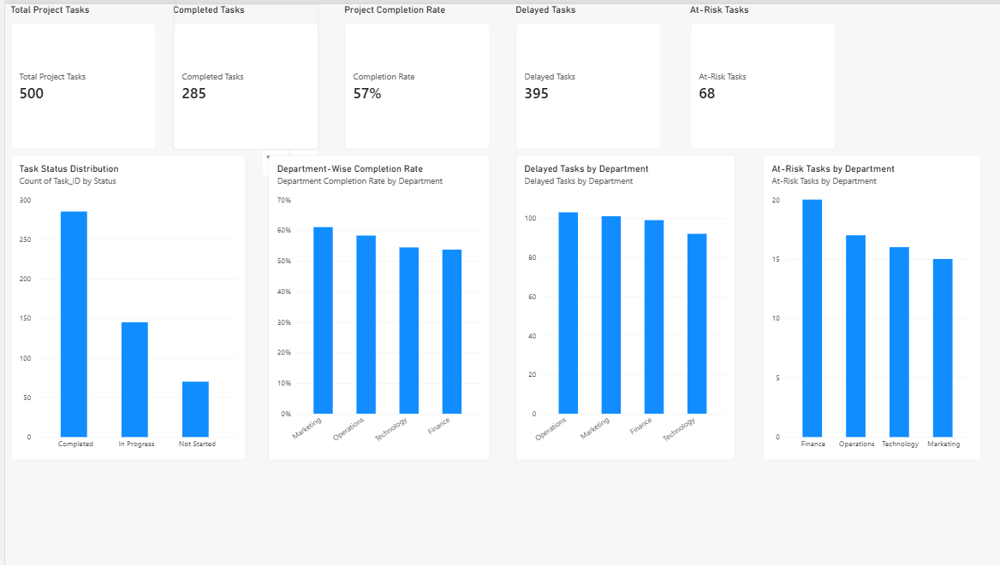

# Cross-Functional Project Execution & Delivery Tracker

## Project Overview

Developed a project management analytics solution using
Python, SQL, Excel, and Power BI to monitor task execution,
department performance, project delays, and delivery risks.

The project simulates the launch of a food delivery service
across Delhi, Mumbai, Bangalore, and Hyderabad.

The dataset contains 500 synthetic project tasks across
Operations, Marketing, Technology, and Finance.

## Tools & Technologies

- Python (Pandas, NumPy, Matplotlib)
- SQL and SQLite
- Microsoft Excel
- Power BI and DAX
- Git and GitHub

## Key Performance Indicators

| KPI | Result |
|-----|--------|
| Total Tasks | 500 |
| Completed Tasks | 285 |
| In Progress | 145 |
| Not Started | 70 |
| Completion Rate | 57.00% |
| Delayed Tasks | 395 |
| At-Risk Tasks | 68 |
| On-Time Completion Rate | 36.84% |

## Department Performance

| Department | Total Tasks | Completed | Completion Rate |
|------------|-------------|-----------|-----------------|
| Marketing | 136 | 83 | 61.03% |
| Operations | 127 | 74 | 58.27% |
| Technology | 114 | 62 | 54.39% |
| Finance | 123 | 66 | 53.66% |

## Key Business Insights

1. Marketing has the highest task completion rate at 61.03%.
2. Finance has the lowest completion rate at 53.66%.
3. Operations has the highest number of delayed tasks (103).
4. Finance has the highest number of at-risk tasks (20).
5. The overall completion rate is 57%.

## Business Recommendations

1. Prioritize high-risk tasks across all departments.
2. Conduct weekly reviews of delayed milestones.
3. Assign clear owners to overdue activities.
4. Improve coordination between functional teams.
5. Monitor completion rates and project risks using Power BI.
6. Escalate critical delivery blockers to project managers.

## Power BI Dashboard

The dashboard includes:

- Total Project Tasks
- Completed Tasks
- Completion Rate
- Delayed Tasks
- At-Risk Tasks
- Task Status Distribution
- Department-Wise Completion Rate
- Delayed Tasks by Department
- At-Risk Tasks by Department

### Dashboard Preview

## Project Structure

- data/ : Synthetic project dataset and SQLite database
- scripts/ : Data generation, analysis, and visualization
- sql/ : SQL queries for project performance
- reports/ : Charts and analytical summaries
- dashboard/ : Power BI dashboard and screenshot

## Data Disclaimer

All project data is synthetic and generated for portfolio
demonstration. Findings and recommendations are illustrative,
not actual operational results.
